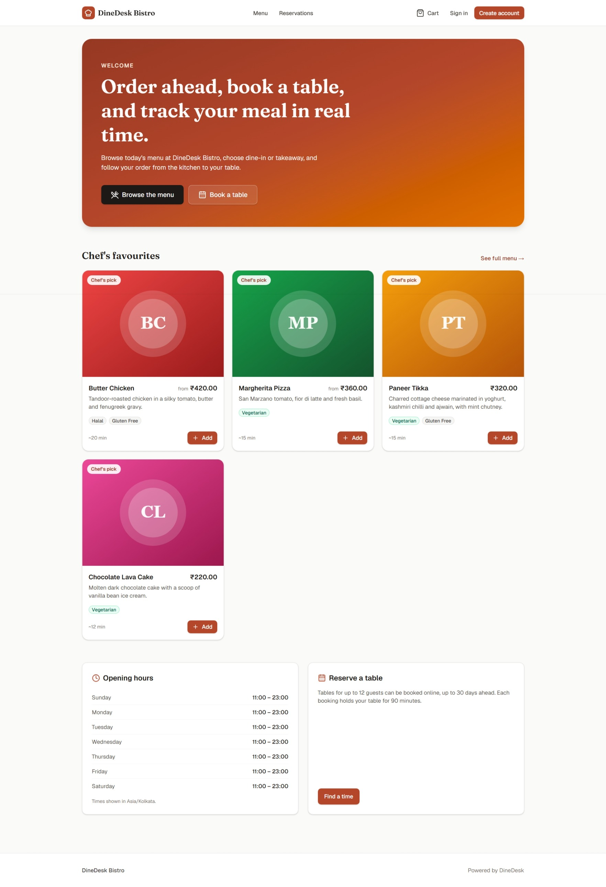
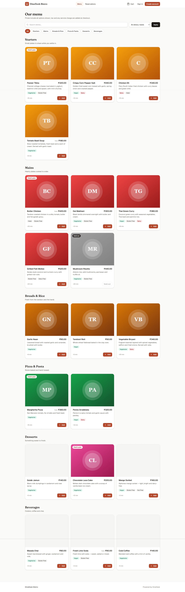
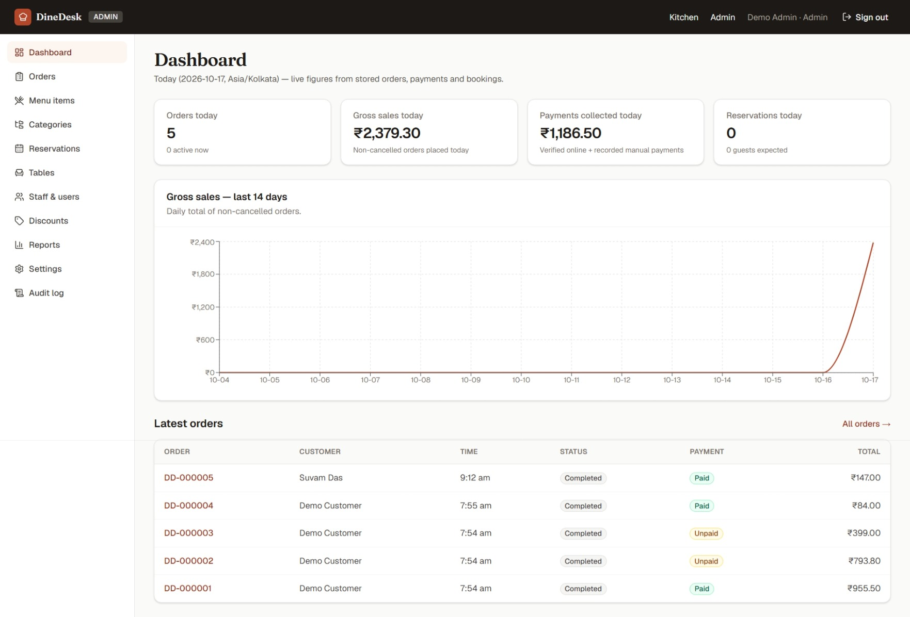

# DineDesk - Restaurant Ordering Platform

DineDesk is a full-stack restaurant ordering platform built with modern web technologies and deployed using Docker.

## Features

- Restaurant menu and item listings
- Customer authentication
- Cart and ordering workflow
- Reservation management
- Administrative functionality
- PostgreSQL database integration
- Docker-based deployment with Nginx reverse proxy
- Application health monitoring

## Technology Stack

- **Frontend and application:** Next.js, React, TypeScript
- **Database:** PostgreSQL
- **ORM:** Prisma
- **Authentication:** Better Auth
- **Deployment:** Docker, Docker Compose, Nginx

## Architecture

DineDesk uses a containerized architecture consisting of a web application, a PostgreSQL database, and an Nginx reverse proxy.

For a high-level overview, see [Architecture Documentation](docs/architecture.md).

## Screenshots

### Homepage

### Menu

### Admin Dashboard

## Security and Privacy

This public repository is intended as a project showcase. It excludes the application's source code, environment files, credentials, database contents, and private deployment configuration.

## Repository Contents

This repository contains project documentation and selected screenshots. It does not contain the executable application or its source code.

## Demo

A public demo URL can be added here when a secure public deployment is available.

## Contact

For project-related inquiries, please contact me through my GitHub profile.
